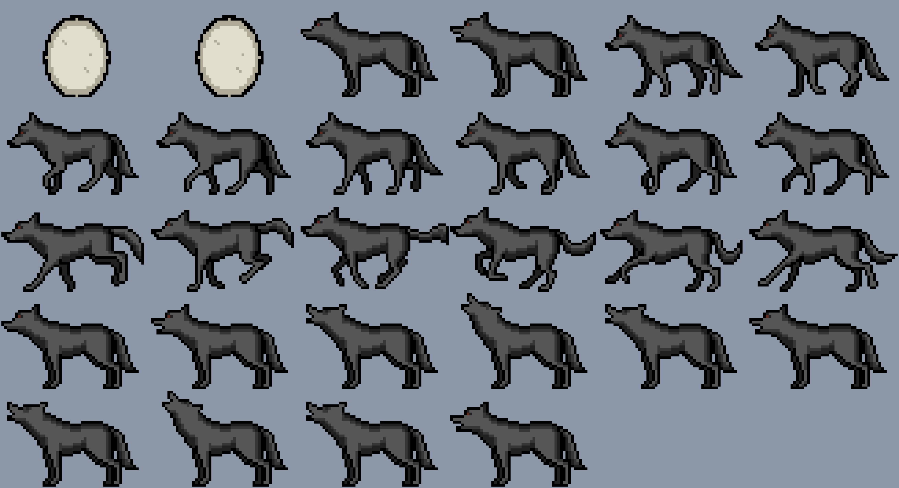

# Bichito (Cardputer ADV)

Mascota virtual para el M5Stack Cardputer ADV. Tiene hambre, ánimo, energía y
limpieza, envejece en etapas, se enferma si lo abandonas y guarda su estado en
la flash, así que sigue siendo el mismo bicho después de apagarlo.

## Estado

Sprints 1 y 2 terminados. La mascota es un lobo de pixel art con 28 cuadros en
cinco clips, que camina, corre y aúlla paseándose por la pantalla, y que
**reacciona al mundo real**: cuenta tus pasos con el acelerómetro, nota cuando
agitas el equipo y se asusta con los ruidos fuertes. El firmware compila contra M5Cardputer y
M5Unified reales y las 12 pruebas del núcleo pasan en el Mac. Falta probarlo
en el equipo.



## Qué hay en la carpeta

```
platformio.ini                   dos entornos: el equipo y las pruebas
lib/nucleo/
  Bichito.h / Bichito.cpp        la lógica del juego, sin una línea de Arduino
  Movimiento.h / .cpp            contador de pasos y detector de agitón
arte/
  bicho.txt                      el dibujo, un caracter por pixel
  previa.png / previa.gif        generados, para mirarlos sin flashear
src/
  main.cpp                       arranque y bucle principal
  Pantalla.h / Pantalla.cpp      dibujo sobre un lienzo de 240 x 135
  Animador.h / Animador.cpp      qué clip toca, dónde está y hacia dónde mira
  ArteBicho.h                    GENERADO, no editar: sale de arte/bicho.txt
  Entrada.h / Entrada.cpp        teclado a acciones
  Sensores.h / Sensores.cpp      BMI270 y micrófono, enchufados al núcleo
  Almacen.h / Almacen.cpp        guardado en NVS
  Reloj.h / Reloj.cpp            hora por NTP, que aquí no es un detalle
  secretos.ejemplo.h             plantilla para los datos de tu red
test/test_nucleo/
  test_bichito.cpp               pruebas del núcleo, corren en el Mac
test/test_movimiento/
  test_movimiento.cpp            pruebas de pasos y agitón, con señales falsas
herramientas/
  arte.py                        bicho.txt a header, PNG y GIF; e importa PNG
```

La separación importante es `lib/nucleo`: no incluye nada de Arduino, así que
toda la lógica del juego se compila y se prueba en el Mac en un segundo. El
hardware queda confinado a `src/`.

## Compilar y subir

PlatformIO quedó instalado en un entorno virtual aparte, en `~/.venvs/platformio`.
El Python de Homebrew rechaza instalar paquetes al sistema, y un entorno virtual
dentro del proyecto se rompería porque el Escritorio está sincronizado con
iCloud. Si hay que rehacerlo:

```bash
python3 -m venv ~/.venvs/platformio && ~/.venvs/platformio/bin/pip install platformio
```

Compilar y subir, con el Cardputer conectado por USB-C:

```bash
~/.venvs/platformio/bin/pio run -e cardputer-adv -t upload && ~/.venvs/platformio/bin/pio device monitor
```

Las pruebas del núcleo no necesitan el equipo ni la cadena de Espressif, y
tardan unos segundos:

```bash
~/.venvs/platformio/bin/pio test -e pruebas
```

## Las teclas

| Tecla | Qué hace |
|---|---|
| `A` | darle de comer |
| `L` | limpiarlo |
| `J` | jugar con él |
| `D` | acostarlo, o despertarlo si ya duerme |
| `M` | darle el remedio, solo sirve si está enfermo |
| `R` | volver al huevo y empezar de nuevo |

Cuando una acción no corresponde, por ejemplo darle de comer dormido o jugar
sin energía, suena un tono grave y aparece el aviso abajo.

## Los sensores

El acelerómetro y el micrófono alimentan los `Estimulos` que el núcleo ya sabía
consumir desde el sprint 1:

| Qué pasa | Qué detecta | Qué le hace al bicho |
|---|---|---|
| Caminas con el equipo encima | picos rítmicos en el BMI270 | le sube el ánimo, un poco por paso |
| Agitas el equipo | vaivén fuerte, 4 cambios de sentido en 700 ms | lo toma como cariño y sale corriendo |
| Ruido fuerte cerca | RMS del micrófono sobre el umbral | lo asusta, le baja el ánimo y lo despierta |

La parte difícil no es leer el sensor sino decidir qué es un paso. Esa lógica
está en `lib/nucleo/Movimiento.h`, sin Arduino, y se prueba en el Mac con
señales sintéticas a 100 Hz. Dos decisiones que las pruebas dejan fijas:

- **Un pico suelto no es un paso.** Hay que encadenar tres con un ritmo
  creíble antes de empezar a sumar. Si no, dejar el equipo en la mesa y darle
  un golpe contaría pasos.
- **Caminar no es un agitón, y un tirón suelto tampoco.** El agitón exige
  cambios de sentido repetidos, y después se enfría 1,2 s para no contar diez
  veces el mismo.

### El altavoz y el micrófono no caben juntos

Comparten el bus de audio del ES8311, y M5Unified deja encendido solo uno. Por
eso `sonar()` suelta el micrófono, hace sonar el tono y lo vuelve a tomar 300 ms
después. **Esto es lo menos verificado de todo el proyecto.** Si en el equipo
se porta mal, hay un escape de una línea en `Sensores.h`:

```cpp
#define BICHITO_CON_MICROFONO 0
```

Con eso el micrófono queda fuera y todo lo demás sigue igual.

### El umbral de ruido se calibra solo

No hay número fijo que ajustar. El detector sigue el nivel de fondo y dispara
cuando algo lo supera por mucho: `fondo x 5 + 80`. El fondo sube despacio y
baja rápido, así que un ruido corto casi no lo mueve, pero si el ambiente se
pone ruidoso de verdad el detector se acostumbra en vez de dispararse solo.

Medido en el equipo: una pieza tranquila da un RMS de fondo de **5 a 16**, con
picos sueltos de hasta 64 que no llegan a disparar. Una palmada a medio metro
midió **513**, contra un umbral de unos 120 en ese momento. Margen de sobra.

El monitor serie imprime los cuatro números por si hace falta mirarlos:

```
[sensores] pasos 10  ruido 94  pico 513  fondo 36
```

## Cómo pasa el tiempo

El Cardputer ADV no tiene RTC, y esto es lo que condiciona el diseño. El estado
se guarda en NVS cada 30 segundos y en cada acción, junto con el epoch de ese
momento. Al prender, el programa pide la hora por NTP, calcula el hueco y se lo
cobra al bicho de una vez.

Sin red configurada todo funciona igual, pero el bicho deja de envejecer
mientras el equipo está apagado: solo cuenta el tiempo encendido. Para activar
la sincronización, copia `src/secretos.ejemplo.h` a `src/secretos.h` y pon tu
red. Ese archivo está en `.gitignore`.

Dos decisiones que conviene conocer antes de tocar el ritmo del juego:

- El castigo por ausencia se corta a los siete días. Volver después de un mes
  no tiene por qué ser peor que volver después de una semana.
- Los huecos largos se parten en tramos de un minuto, así que cobrarle ocho
  horas apagado da el mismo resultado que haberlas pasado encendido. Sin eso,
  diez minutos de hambre al final de un hueco largo contaban como ocho horas
  de descuido. Hay una prueba que fija ese comportamiento.

## Ajustes rápidos

| Qué cambiar | Dónde |
|---|---|
| Qué tan rápido da hambre | `Bichito.h`, `struct Ritmo` |
| Cuándo nace, cuándo crece | `Bichito.h`, `namespace tiempos` |
| Cuánto aguanta sin enfermarse | `Bichito.h`, `kDescuidoEnferma` |
| El dibujo del bicho | `arte/bicho.txt`, y volver a correr `arte.py` |
| Qué tan clara es la habitación | `Pantalla.cpp`, `kCielo` y `kPiso` |
| El color de cada humor | `Pantalla.cpp`, `tintePara` |
| Cuánto corre y a qué velocidad | `Animador.cpp`, las constantes de arriba |
| La distribución de la pantalla | `Pantalla.cpp`, las constantes de `Pantalla` |
| Las teclas | `Entrada.cpp` |
| Qué tan fácil cuenta un paso | `Movimiento.h`, `ContadorPasos::Ajustes` |
| Qué tan fuerte hay que agitar | `Movimiento.h`, `DetectorSacudida::Ajustes` |
| El umbral de palmada | `Sensores.cpp`, `kUmbralRuido` |

## El arte

El lobo es de **ScratchiO**, del paquete *Animated Wild Animals* de
OpenGameArt, con licencia **CC0 de dominio público**. Las hojas originales
están en `arte/origen/` junto con el detalle y el comando para reimportarlas.

`arte/bicho.txt` es el arte ya convertido: un caracter por pixel, cuadros de
54 x 35 que en pantalla se ven a escala 2, o sea 108 x 70 de los 240 x 135.
Se puede editar a mano. Después de tocarlo:

```bash
python3 herramientas/arte.py
```

Eso regenera `src/ArteBicho.h` y las dos vistas previas. El GIF sirve para ver
el movimiento sin flashear nada.

| Clip | Cuadros | Cuándo sale |
|---|---|---|
| `huevo` | 2 | los primeros 3 minutos de vida |
| `quieto` | 2 | parado, y también comiendo, durmiendo o muerto |
| `camina` | 8 | cruzando la pantalla sin ganas |
| `corre` | 6 | cruzando la pantalla contento, o al jugar |
| `aulla` | 10 | de vez en cuando, estando quieto |

Tres cosas que conviene saber antes de tocar el arte:

- **El paquete no trae poses de comer ni de dormir.** Esos estados usan el clip
  `quieto` y se distinguen por lo que dibuja la pantalla: un plato a los pies
  mientras come, y los zZz con la paleta teñida de azul mientras duerme.
  Inventar esas dos poses a mano quedaría fuera de estilo; lo limpio sería
  conseguirlas dibujadas por alguien.
- **La habitación va clara a propósito.** El lobo es gris oscuro con contorno
  negro y sobre el fondo casi negro de las franjas se perdía entero.
- **El lobo está dibujado mirando a la izquierda.** Por eso `Animador::espejado()`
  devuelve verdadero justo cuando camina hacia la derecha.

El huevo sí está dibujado a mano, con dos tonos claros propios, porque la
paleta del lobo es toda oscura y un huevo negro no se entiende.

### Traer otra hoja de sprites

El importador acepta varias hojas de una vez, cada una con su nombre de clip,
y recorta el margen vacío que comparten todos los cuadros:

```bash
python3 herramientas/arte.py importar 64x40 \
  quieto=Howl.png:0-1 camina=Walk.png corre=Run.png
```

El `:0-1` elige un rango de cuadros de esa hoja. El recorte usa **una sola
caja para todos los cuadros**: si cada uno se recortara a su medida, la
animación saltaría en pantalla.

Pide PNG de 8 bits sin entrelazado y como máximo 15 colores, que es lo normal
en pixel art. Una hoja **direccional**, de esas con el mismo personaje mirando
hacia ocho lados, no sirve: son poses sueltas y lo que necesita este juego es
un ciclo de cuadros de perfil.

## Qué está probado

Verificado **en el equipo**, con el Cardputer conectado:

- Arranca y dibuja bien: `[pantalla]` da 240 x 135 y la distribución completa
  se ve derecha, con el lobo, las cuatro barras y la ayuda de teclas.
- `[sensores] IMU lista` y `microfono listo`: los dos sensores arrancan, lo que
  de paso valida que soltar el altavoz para tomar el micrófono funciona.
- El acelerómetro cuenta al moverlo y **se queda quieto en reposo**: 35 s sobre
  la mesa sin sumar un solo paso falso.
- El micrófono detecta una palmada con margen amplio, 513 contra un umbral de
  unos 120.
- El estado sobrevive al reflasheo: `estado recuperado, edad 390s`.

Verificado en el Mac:

- El firmware compila completo contra M5Cardputer 1.1.0 y M5Unified 0.2.29, sin
  ninguna advertencia en nuestro código. Ocupa 24 KB de RAM estática (7,4 %) y
  592 KB de flash (17,7 %), con los 28 cuadros de arte adentro, que son 26 KB.
- El GIF que genera `arte.py` lo decodifica `sips` y sale el cuadro correcto.
  Esa comprobación encontró un error real: el codificador LZW ensanchaba el
  código un paso antes de tiempo y el GIF salía en negro.
- **22 pruebas pasan** en el Mac. Las 12 de `test_bichito.cpp`: eclosión,
  hambre, empacho, sueño con despertar automático, enfermedad por descuido,
  muerte por abandono, equivalencia entre cobrar de golpe y segundo a segundo,
  y ida y vuelta del guardado incluyendo el rechazo de versiones viejas. Las 10
  de `test_movimiento.cpp`: cuenta caminata a distintas frecuencias, ignora un
  golpe suelto, ignora picos demasiado lentos, ignora un cambio de inclinación,
  detecta el agitón sin confundirlo con caminar, y el enfriamiento evita contar
  el mismo agitón dos veces.

Todavía no verificado, hace falta el equipo encendido:

- La distribución exacta en los 240 x 135, que ningún texto se salga y que el
  bicho no se escape por el borde. Las cuentas cuadran, pero eso se confirma
  recién al correrlo. El lienzo son 65 KB de heap, que el ESP32-S3 tiene de
  sobra.
- Que dibujar 640 pixeles a escala 3 con `fillRect` dé los 20 cuadros por
  segundo. Si va lento, el cambio es pasar a `pushImage` con un buffer.
- Que el teclado del ADV responda como espera `Entrada.cpp`. El ADV lleva un
  controlador I2C (TCA8418) en vez de la matriz GPIO del Cardputer original,
  por eso el `platformio.ini` exige M5Cardputer 1.1.0 o mayor y M5Unified
  0.2.8 o mayor, que ya detectan la placa solas.
- Que el tono del altavoz salga por el codec ES8311, y que el baile de soltar
  y retomar el audio entre altavoz y micrófono no deje a ninguno mudo.
- Un paseo largo de verdad: lo que se midió fue el equipo manipulado en la
  mano, no treinta pasos caminando.
- La sincronización NTP, que necesita `secretos.h` con una red configurada.
- Que la sincronización NTP ande, y con ella el cobro del tiempo apagado.

## Lo que falta

**Sprint 3, lo social.** ESP-NOW entre dos Cardputers para que las mascotas se
conozcan, o el emisor IR (pin G44) para lo mismo apuntando uno al otro.

**Las dos poses que faltan.** Comer y dormir se resuelven hoy con señales en
pantalla. Si aparece una hoja con esas poses en el mismo estilo, entran por el
importador sin tocar el firmware.

**Ideas sueltas.** Ponerle nombre en la primera partida; que el bicho reaccione
al borde de la pantalla; un cementerio con los bichos anteriores; diálogos por
LLM cuando hay Wi-Fi.
