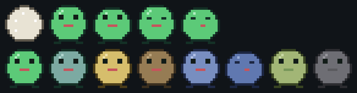

# Bichito (Cardputer ADV)

Mascota virtual para el M5Stack Cardputer ADV. Tiene hambre, ánimo, energía y
limpieza, envejece en etapas, se enferma si lo abandonas y guarda su estado en
la flash, así que sigue siendo el mismo bicho después de apagarlo.

## Estado

Sprint 1 terminado: núcleo del juego, pantalla, teclado, sonido y guardado.
El núcleo está probado en el Mac, con 12 pruebas que pasan.

El firmware todavía no se ha compilado contra las librerías reales de M5Stack,
porque este Mac no tiene PlatformIO instalado. Lo que está verificado y lo que
no está más abajo, en "Qué está probado".

## Qué hay en la carpeta

```
platformio.ini                   dos entornos: el equipo y las pruebas
lib/nucleo/
  Bichito.h / Bichito.cpp        la lógica del juego, sin una línea de Arduino
src/
  main.cpp                       arranque y bucle principal
  Pantalla.h / Pantalla.cpp      dibujo sobre un lienzo de 240 x 135
  Sprites.h                      los cuadros del bicho, en arte ASCII
  Entrada.h / Entrada.cpp        teclado a acciones
  Almacen.h / Almacen.cpp        guardado en NVS
  Reloj.h / Reloj.cpp            hora por NTP, que aquí no es un detalle
  secretos.ejemplo.h             plantilla para los datos de tu red
test/test_nucleo/
  test_bichito.cpp               pruebas del núcleo, corren en el Mac
herramientas/
  vista_previa.py                dibuja los sprites en un PNG, sin flashear
```

La separación importante es `lib/nucleo`: no incluye nada de Arduino, así que
toda la lógica del juego se compila y se prueba en el Mac en un segundo. El
hardware queda confinado a `src/`.

## Compilar y subir

Hace falta PlatformIO, que en este Mac todavía no está:

```bash
python3 -m pip install --user platformio
```

Después, con el Cardputer conectado por USB-C:

```bash
pio run -e cardputer-adv -t upload && pio device monitor
```

La primera compilación se baja la cadena de herramientas de Espressif, que son
varios cientos de megas. Las siguientes son rápidas.

Las pruebas del núcleo no necesitan el equipo ni la cadena de Espressif:

```bash
pio test -e pruebas
```

## Las teclas

| Tecla | Qué hace |
|---|---|
| `A` | darle de comer |
| `L` | limpiarlo |
| `J` | jugar con él |
| `D` | acostarlo, o despertarlo si ya duerme |
| `M` | darle el remedio, solo sirve si está enfermo |
| `R` | volver al huevo y empezar de nuevo |

Cuando una acción no corresponde, por ejemplo darle de comer dormido o jugar
sin energía, suena un tono grave y aparece el aviso abajo.

## Cómo pasa el tiempo

El Cardputer ADV no tiene RTC, y esto es lo que condiciona el diseño. El estado
se guarda en NVS cada 30 segundos y en cada acción, junto con el epoch de ese
momento. Al prender, el programa pide la hora por NTP, calcula el hueco y se lo
cobra al bicho de una vez.

Sin red configurada todo funciona igual, pero el bicho deja de envejecer
mientras el equipo está apagado: solo cuenta el tiempo encendido. Para activar
la sincronización, copia `src/secretos.ejemplo.h` a `src/secretos.h` y pon tu
red. Ese archivo está en `.gitignore`.

Dos decisiones que conviene conocer antes de tocar el ritmo del juego:

- El castigo por ausencia se corta a los siete días. Volver después de un mes
  no tiene por qué ser peor que volver después de una semana.
- Los huecos largos se parten en tramos de un minuto, así que cobrarle ocho
  horas apagado da el mismo resultado que haberlas pasado encendido. Sin eso,
  diez minutos de hambre al final de un hueco largo contaban como ocho horas
  de descuido. Hay una prueba que fija ese comportamiento.

## Ajustes rápidos

| Qué cambiar | Dónde |
|---|---|
| Qué tan rápido da hambre | `Bichito.h`, `struct Ritmo` |
| Cuándo nace, cuándo crece | `Bichito.h`, `namespace tiempos` |
| Cuánto aguanta sin enfermarse | `Bichito.h`, `kDescuidoEnferma` |
| El dibujo del bicho | `Sprites.h`, los cuadros son editables a mano |
| Los colores de cada humor | `Pantalla.cpp`, `paletaPara` |
| La distribución de la pantalla | `Pantalla.cpp`, `dibujar` |
| Las teclas | `Entrada.cpp` |

Los sprites son arte ASCII de 16 x 16 que se dibuja a escala 5. Cambiar un
caracter cambia el dibujo, sin herramientas y sin microSD. Para ver cómo quedó
sin flashear:

```bash
python3 herramientas/vista_previa.py
```



Arriba los cuadros de animación: huevo, quieto, respirando, parpadeando y
dormido. Abajo el mismo cuerpo con la paleta de cada humor. La herramienta lee
`src/Sprites.h` directamente, así que el arte no se puede desincronizar.

## Qué está probado

Verificado de verdad:

- El núcleo compila con `clang++ -Wall -Wextra` sin advertencias.
- Las 12 pruebas de `test_bichito.cpp` pasan: eclosión, hambre, empacho, sueño
  con despertar automático, enfermedad por descuido, muerte por abandono,
  equivalencia entre cobrar de golpe y segundo a segundo, y ida y vuelta del
  guardado incluyendo el rechazo de versiones viejas.

Todavía no verificado, hace falta el equipo:

- Que el firmware compile contra M5Cardputer y M5Unified reales.
- La distribución exacta en los 240 x 135, y que ningún texto se salga.
- Que el teclado del ADV responda como espera `Entrada.cpp`. El ADV lleva un
  controlador I2C (TCA8418) en vez de la matriz GPIO del Cardputer original,
  por eso el `platformio.ini` exige M5Cardputer 1.1.0 o mayor y M5Unified
  0.2.8 o mayor, que ya detectan la placa solas.
- Que el tono del altavoz salga por el codec ES8311.

## Lo que falta

**Sprint 2, los sensores.** Es donde deja de parecer una demo. El hueco ya está
hecho: `estimulosDelMundo()` en `main.cpp` devuelve vacío y el núcleo ya sabe
qué hacer con pasos, caricias y ruido.

- BMI270 por `M5Cardputer.Imu`: contar pasos para subir el ánimo, detectar el
  agitón como caricia.
- Micrófono por `M5Cardputer.Mic`: una palmada lo despierta y lo asusta.

**Sprint 3, lo social.** ESP-NOW entre dos Cardputers para que las mascotas se
conozcan, o el emisor IR (pin G44) para lo mismo apuntando uno al otro.

**Ideas sueltas.** Ponerle nombre en la primera partida; sprites desde la
microSD en vez de arte ASCII; un cementerio con los bichos anteriores; diálogos
por LLM cuando hay Wi-Fi.
